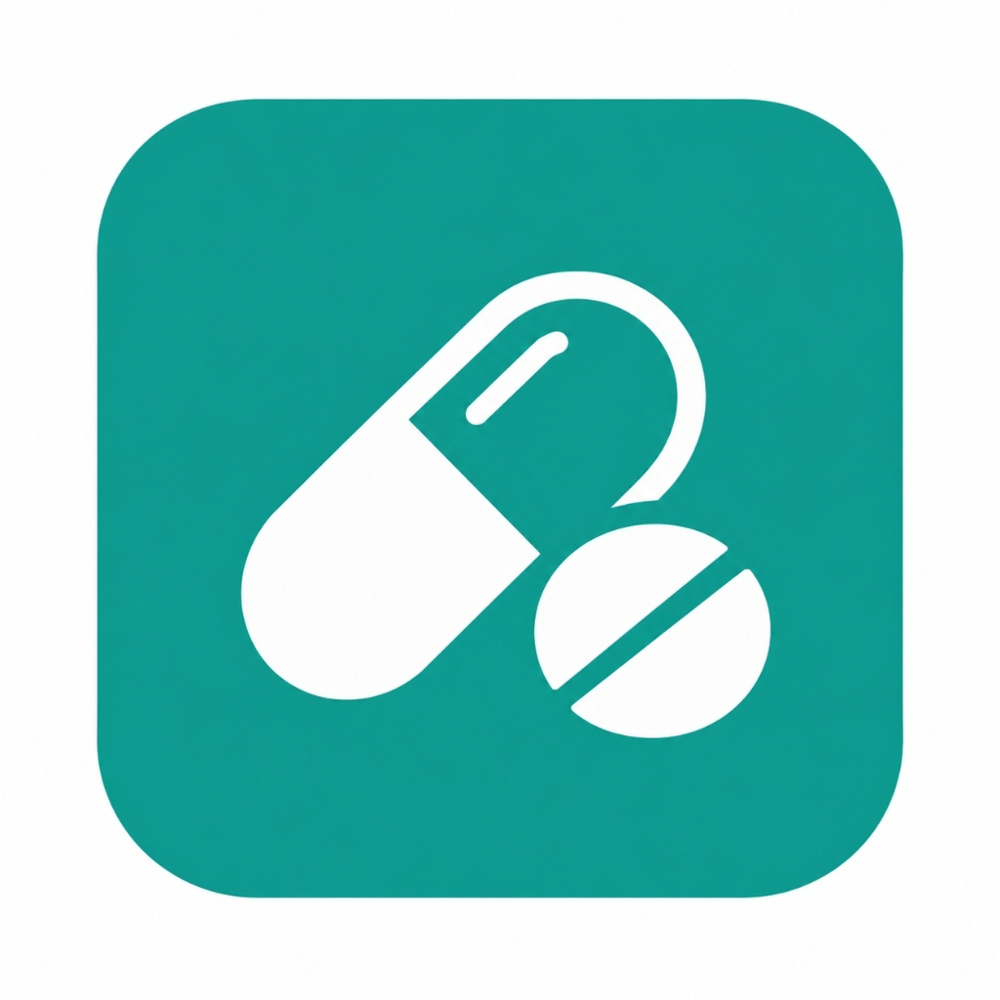
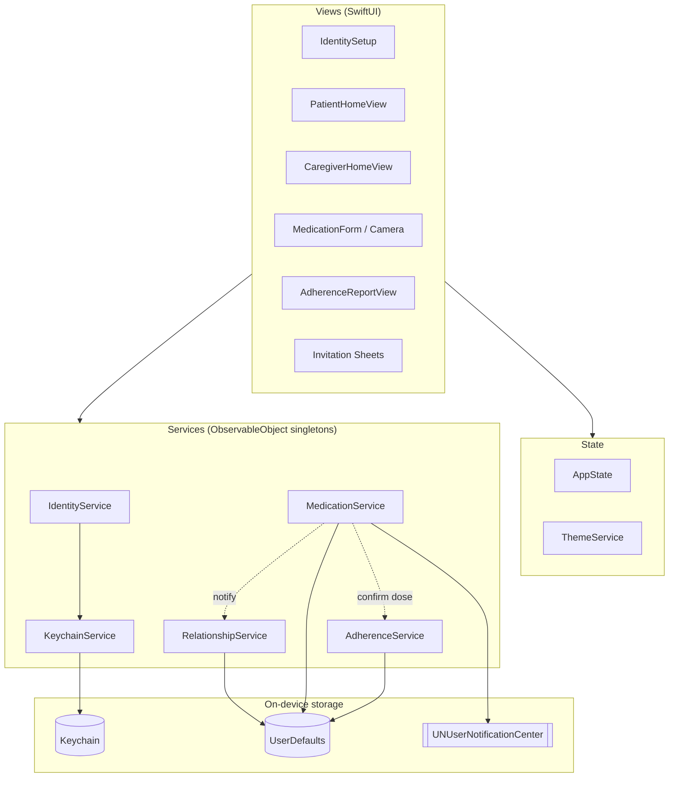
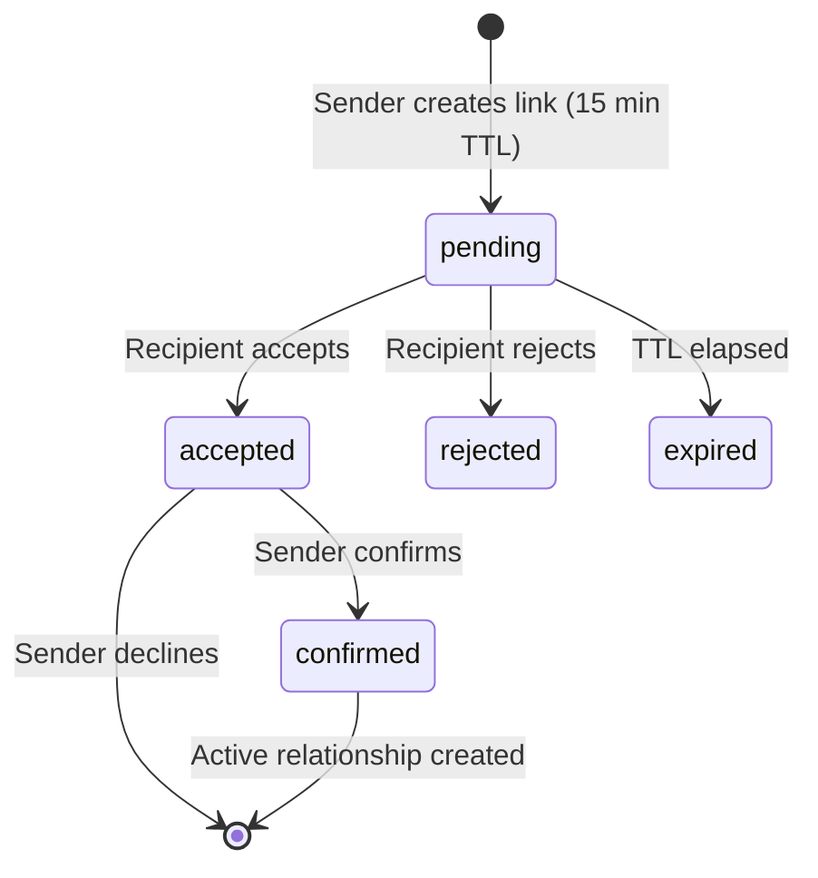

<div align="center">



# Dawai · دواء

**A medication reminder and caregiver-monitoring app for iPhone, built Arabic-first with SwiftUI.**


-green)
-lightgrey)

</div>

---

## Table of Contents

1. [Overview](#overview)
2. [Features](#features)
3. [Use Cases](#use-cases)
4. [Architecture](#architecture)
5. [Project Structure](#project-structure)
6. [Tech Stack](#tech-stack)
7. [Privacy and Security](#privacy-and-security)
8. [Getting Started](#getting-started)
9. [Developer and Demo Tools](#developer-and-demo-tools)
10. [Releasing to TestFlight](#releasing-to-testflight)
11. [Current Limitations](#current-limitations)
12. [Roadmap](#roadmap)

---

## Overview

**Dawai** (دواء, "medicine") helps people stay on top of their medication, and lets someone they trust follow along.

The app has two roles:

| Role | Arabic | What they do |
|---|---|---|
| **Patient** | مستفيد | Adds medications, receives reminders, confirms each dose. |
| **Caregiver** | مقدم الرعاية | Links to a patient, sees missed doses, adds medications for them, reviews adherence reports. |

Design principles:

- **Arabic-first.** The whole UI is right-to-left with Arabic copy.
- **Privacy by default.** No account, email or phone number is required. Identity is a first name plus a device-generated cryptographic key.
- **Native feel.** SwiftUI system lists, sheets, SF Symbols, and automatic light and dark mode.

---

## Features

### Identity
- No sign-up. Pick a role, enter a first name, and you are in.
- The first name is validated (2 to 40 letters, no digits, symbols or emoji).
- A P-256 signing key is generated on the device and stored in the **Keychain**. A SHA-256 fingerprint of its public key identifies the user.

### Medications
- Add, edit and delete medications with name, dosage, time, days, frequency, duration and instructions.
- Attach a photo of the medication or its box. Images are validated for format (JPG, PNG, HEIC) and size (5 MB maximum).
- **Today's list** is sorted by scheduled time and updates as the day progresses.
- **Local notifications** remind the patient at dose time, and a **missed-dose alert** follows after a **30-minute grace period**.
- Tapping a notification opens the dose confirmation sheet directly.

### Patient and caregiver linking
- Generate a **secure invitation link** (`dawai://invite?token=…`) that is valid for **15 minutes**, with a live countdown, copy and share.
- The recipient reviews the invitation, then accepts or rejects it. The sender confirms to complete a two-step handshake.
- Role compatibility is enforced: a patient can link only with a caregiver. Self-invites, expired tokens and duplicate links are rejected.
- Either side can cancel a pending invitation or disconnect later.

### Collaborative deletion
- A **caregiver** can delete a linked patient's medication directly.
- A **patient** who wants to delete a medication sends a **deletion request**. The caregiver approves or rejects it. This prevents accidental or unnoticed removals.

### Weekly adherence reports
- Pick one of the last 4 weeks, and for caregivers, pick which linked patient.
- See the adherence percentage, daily breakdown, per-medication summary and trend versus the previous week.
- Doses are classified as on time, late or missed.
- Performance tiers: **Excellent** (90% or more), **Good** (75–89%), **Fair** (50–74%), **Low** (below 50%).
- Reports can be shared through the system share sheet.
- Access is permission-checked: only the patient, or a caregiver with an active link to them, can view a report.

### Settings
- Light, dark or system appearance.
- Notification toggle that respects the system permission and links to iOS Settings when notifications are denied.
- Identity details and reset.

---

## Use Cases

The code is organised around numbered use cases. The `UC-n` tags appear in source comments so each feature can be traced to its requirement.

| ID | Use case | Main code |
|---|---|---|
| UC-1 | Set up user identity (role, first name, key pair) | `IdentityService`, `NameValidator`, `KeychainService`, `IdentitySetup/*` |
| UC-2 | Link patient and caregiver | `RelationshipService`, `CreateInvitationSheet`, `ReceiveInvitationSheet` |
| UC-3 | Add medication and schedule reminders | `MedicationService`, `MedicationFormView`, `MedicationCameraView` |
| UC-4 | Receive reminder notification | `NotificationDelegate` in `MedicationService.swift` |
| UC-5 | Missed-dose detection (30-minute grace) | `MedicationService.isDoseMissed` |
| UC-6 | Confirm dose taken, notify caregivers | `MedicationService.confirmDoseTaken` |
| UC-7 | View weekly adherence report | `AdherenceService`, `AdherenceReportView` |
| UC-11 | Collaborative medication deletion | `MedicationService` deletion-request flow |
| UC-12 | Today's medications, auto-sorted by time | `MedicationService.refreshDerivedState` |

---

## Architecture

Dawai uses a lightweight **MVVM with service layer** structure. Services are singletons that publish state through Combine, and SwiftUI views observe them directly.



### Invitation lifecycle



---

## Project Structure

```
Dawai/
├── Dawai.xcodeproj
└── Dawai/
    ├── DawaiApp.swift              # App entry, deep-link handling, notification delegate
    ├── ContentView.swift           # Root: identity setup or home
    ├── Models/
    │   ├── UserIdentity.swift
    │   ├── UserRole.swift
    │   ├── ConnectionInvitation.swift   # Invitation + ActiveRelationship
    │   ├── AdherenceReportModel.swift   # DoseRecord, WeeklyAdherenceReport, tiers
    │   ├── HomeMockData.swift           # MedicationItem + demo data
    │   └── *Error.swift                 # Localized Arabic error types
    ├── Services/
    │   ├── IdentityService.swift
    │   ├── KeychainService.swift
    │   ├── NameValidator.swift
    │   ├── RelationshipService.swift
    │   ├── MedicationService.swift      # Medications, reminders, deletion requests
    │   └── AdherenceService.swift
    ├── ViewModels/
    │   ├── AppState.swift
    │   └── IdentitySetupViewModel.swift
    └── Views/
        ├── IdentitySetup/          # Role selection, name entry
        ├── Home/                   # Patient/Caregiver homes, forms, sheets, reports
        │   └── Components/         # NotificationToastView
        └── Theme/AppTheme.swift    # Colors and ThemeService
```

---

## Tech Stack

| Area | Technology |
|---|---|
| Language | Swift 5 |
| UI | SwiftUI (`NavigationStack`, `List`, sheets, `ShareLink`) |
| Reactive state | Combine, `ObservableObject`, `@MainActor` |
| Notifications | `UserNotifications` (local, with notification-center delegate) |
| Cryptography | `CryptoKit` (P-256 signing key, SHA-256 fingerprint) |
| Secure storage | Keychain (`Security`) |
| Local persistence | `UserDefaults` with `Codable` |
| Photos | `PhotosUI` (`PhotosPicker`) |
| Deep links | Custom URL scheme `dawai://` |
| Dependencies | **None.** Apple frameworks only. |

---

## Privacy and Security

- **No accounts or personal data.** Only a first name is collected, and it is used for display, not authentication.
- **Keychain-backed identity.** The private key never leaves the device.
- **No analytics, no tracking, no network calls.** All data stays on the device.
- **Time-limited invitations.** Links expire after 15 minutes, and a new link replaces any previous pending one.
- **Permission-checked access.** Caregiver actions and adherence reports require an active, confirmed relationship.
- The export-compliance flag `ITSAppUsesNonExemptEncryption` is set to `NO`.

---

## Getting Started

### Requirements

- macOS with **Xcode 15 or later** (built and tested with a recent Xcode release)
- iOS **16.0+** device or simulator
- An Apple Developer account, only for running on a physical device or distributing

### Run

```bash
git clone <your-repository-url>
cd Dawai
open Dawai.xcodeproj
```

1. Select the **Dawai** scheme.
2. Choose an iPhone simulator, or your device.
3. Press **⌘R**.

On a physical device, set your own team under **Signing & Capabilities** and enable *Automatically manage signing*.

### Command-line build

```bash
xcodebuild -project Dawai.xcodeproj \
  -scheme Dawai \
  -destination 'generic/platform=iOS Simulator' \
  build CODE_SIGNING_ALLOWED=NO
```

### Notifications

Allow notifications when prompted. Reminders do not fire on a simulator the same way they do on a device, so test timing-sensitive behavior on real hardware.

---

## Developer and Demo Tools

Because there is no backend, linking two people is simulated on a single device during development.

- **Simulate recipient acceptance** (in the create-invitation sheet, `DEBUG` builds only) marks your outgoing invitation as accepted by a fake counterpart.
- **Generate a compatible incoming invitation** (in the receive-invitation sheet) creates a fake incoming invite so you can test the accept and reject flows.
- Instant reminder and missed-dose simulations exist in `MedicationService` for quick notification testing.
- `RelationshipService.resetForTesting()` clears all invitations and relationships.
- Seed demo beneficiaries and a realistic 4-week dose history are included for exploring reports.

---

## Releasing to TestFlight

Current release settings:

| Setting | Value |
|---|---|
| Bundle ID | `com.wajdwael.dawaiapp` |
| Display name | دواء |
| Version / Build | `1.0` / `1` |
| Minimum iOS | 16.0 |
| Export compliance | `ITSAppUsesNonExemptEncryption = NO` |

Steps:

1. Create the app record in [App Store Connect](https://appstoreconnect.apple.com) (**My Apps → +**) using the bundle ID above. The store name must be globally unique, for example `Dawai - دوائي`.
2. In Xcode, select **Any iOS Device (arm64)**.
3. Run **Product → Archive**.
4. In Organizer, choose **Distribute App → App Store Connect → Upload**.
5. When processing finishes, open the **TestFlight** tab, add testers, and enable a public link if needed.

Increase the **Build** number for every new upload.

**Common issues**

| Message | Fix |
|---|---|
| `PLA Update available` | Accept the updated agreement at developer.apple.com/account. |
| `Failed Registering Bundle Identifier` | Use a unique bundle ID. |
| `App Name already in use` | Choose a more specific store name. |
| `Account credentials have expired` | Xcode → Settings → Accounts → sign in again. |
| `Internet connection appears to be offline` during upload | Disable VPN or Private Relay and retry, or export an `.ipa` and upload with the **Transporter** app. |

---

## Current Limitations

Dawai is currently an **on-device prototype**:

- **No cloud sync or backend.** Invitations, links and notifications between two real phones are not delivered yet. Linking works fully only through the simulated flow on one device.
- Caregivers cannot receive a push notification when a patient misses a dose on another device, because notifications are local.
- Data lives in `UserDefaults` and is lost if the app is deleted. The Keychain identity may persist, depending on iOS behavior.
- The medication photo screen uses the photo library picker, not a live camera.
- Arabic is the only language. There is no localization layer yet.
- Some home-screen content uses demo data until real links exist.

---

## Roadmap

- [ ] Backend (for example CloudKit or Firebase) for real cross-device invitations and sync
- [ ] Push notifications to caregivers for missed doses
- [ ] Live camera capture and medication label recognition
- [ ] English localization alongside Arabic
- [ ] iCloud backup and restore of identity and medications
- [ ] Widgets and Apple Watch reminders
- [ ] Unit and UI test suites for services and flows
- [ ] PDF export of adherence reports

---

<div align="center">

Made with care for patients and the people who look after them.

</div>

